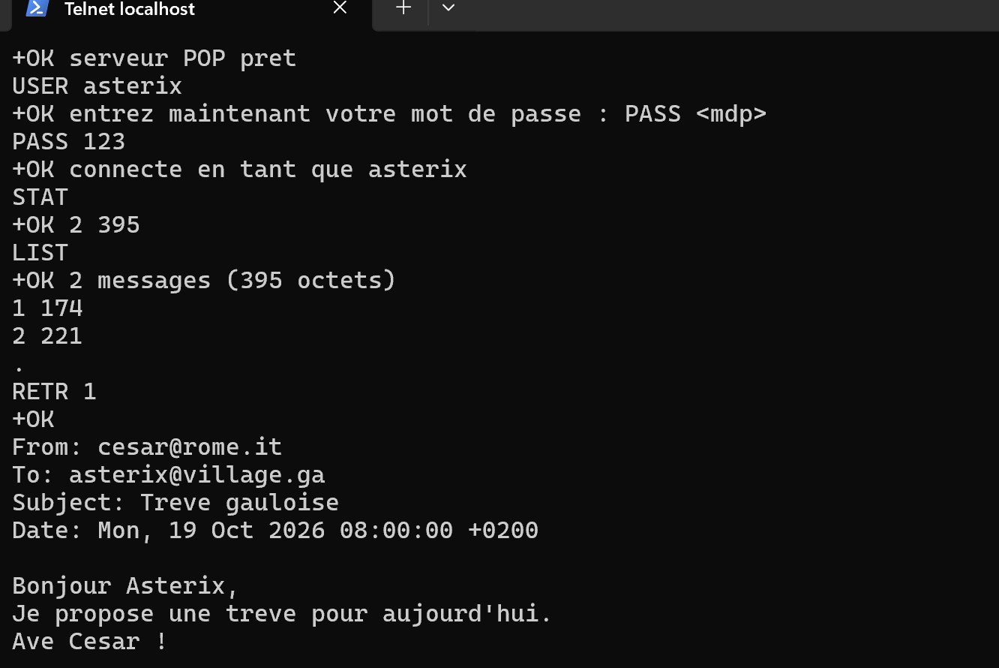
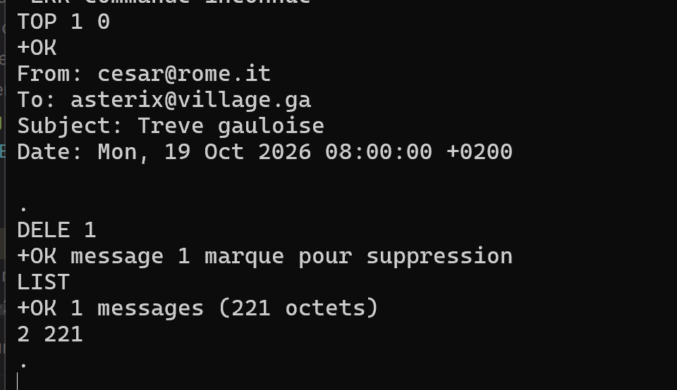
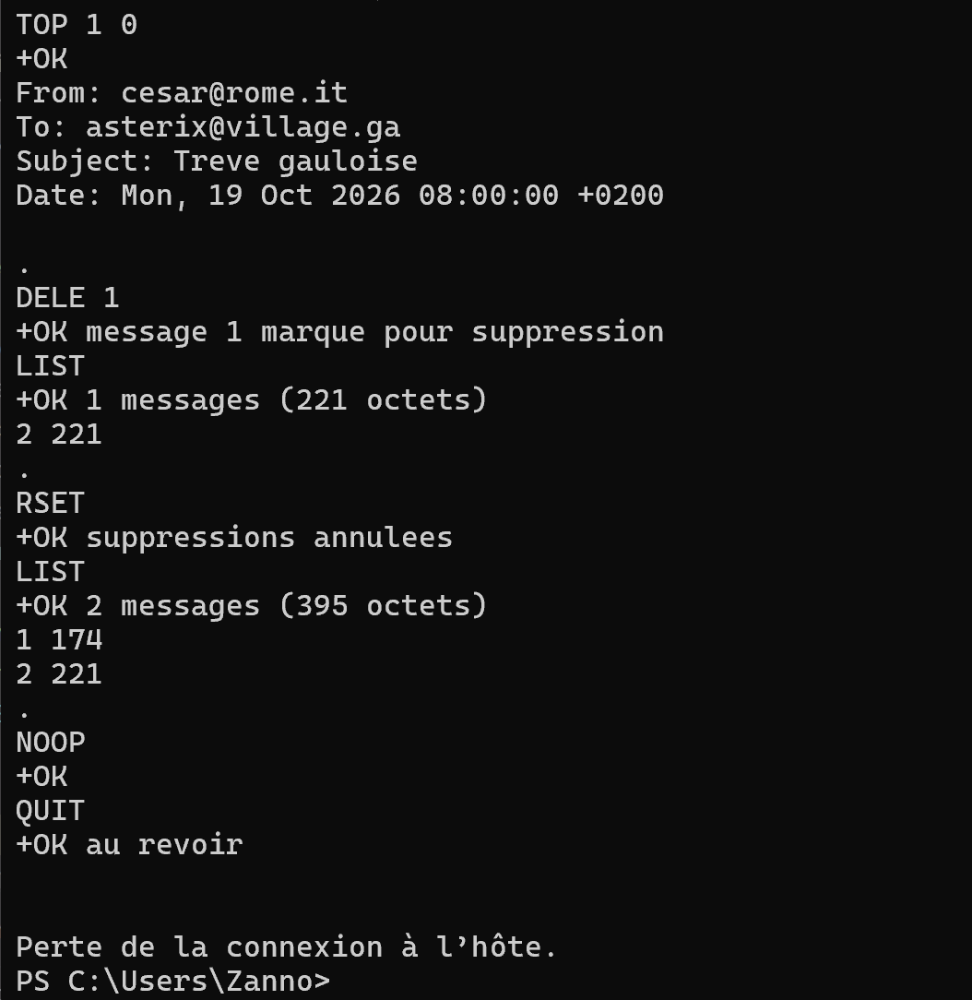
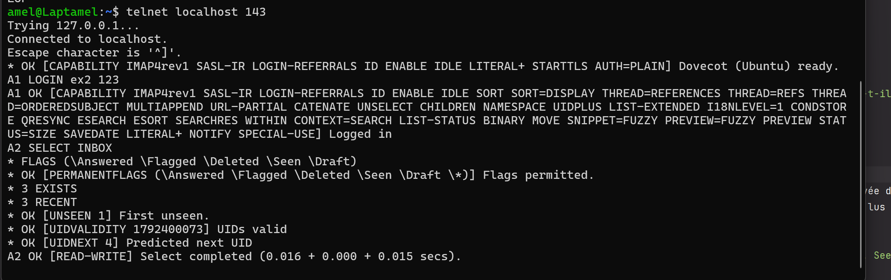
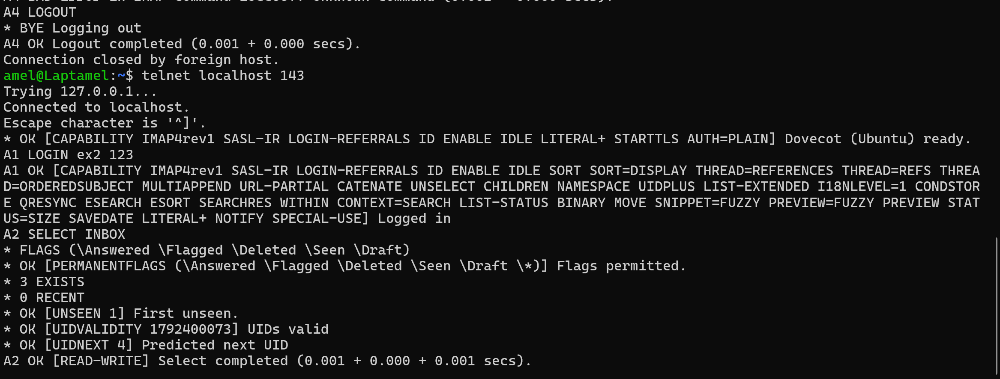
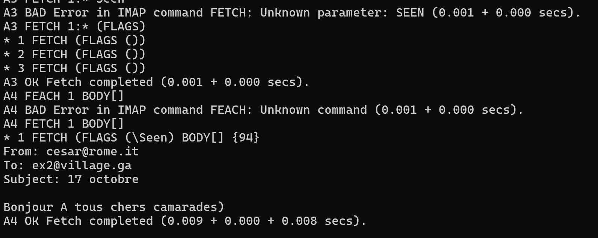
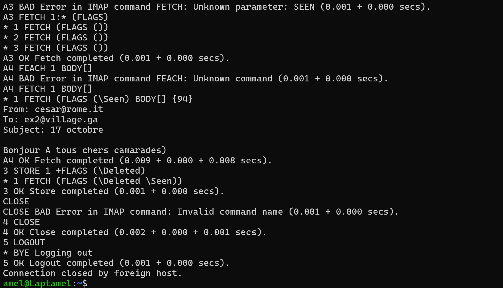
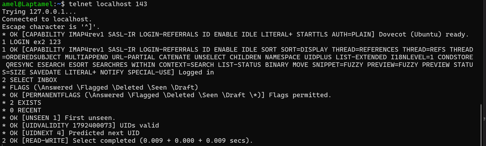

# Compte-Rendu : TP n°5 - Protocole IMAP
**ARSIR - Polytech Lyon (4A)**  
**Enseignants :** M. MORGE & N. SALAZAR  
**Année :** 2026–2027  
**Groupe :** 12 - VOICU David et ZANNOUH Amel
---


## EXERCICE 1 : Serveur POP

### Q1. Implémentez un serveur POP capable de traiter les commandes du tableau 1.

Le serveur POP3 a été implémenté en Java dans [`src/Ex1/ServeurPOP.java`](src/Ex1/ServeurPOP.java).  
Il gère deux utilisateurs (`asterix` et `obelix` / `cesar` avec les mots de passe associés), stocke les boîtes dans des dossiers (`boites/asterix/`, `boites/cesar/`) et les mails sous forme de fichiers texte.






## EXERCICE 2 : Utilisation d'IMAP


### Q1.1. Que renvoie la commande SELECT INBOX?



```
SELECT INBOX ouvre la boîte et renvoie :
- Le nombre total de messages dans la boîte
- Le nombre de nouveaux messages récents (
- Le numéro du premier mail non lu 
- La liste des drapeaux supportés et modifiables 
- La validité et le prochain identifiant unique.
- La confirmation que la boîte est ouverte en lecture/écriture (OK [READ-WRITE]).
```

### Q1.2. Déconnectez et reconnectez-vous, puis réutilisez SELECT INBOX. Le résultat a-t-il changé ? Pourquoi ?



```
Oui, le nombre de messages récents passe de 3 à 0 (* 0 RECENT).
Le drapeau Recent est temporaire : il avertit uniquement la première session de l'arrivée de nouveaux messages. 
Une fois la boîte ouverte une première fois, les messages ne sont plus considérés comme récents pour les sessions suivantes.
En revanche, le nombre total de messages ne change pas (* 3 EXISTS) et ils restent non lus (* OK [UNSEEN 1]).
```

### Q1.3. Le protocole IMAP utilise des drapeaux pour marquer l’état des messages (e.g. Seen, Answered, Deleted, Recent).La commande FETCH 1:* (FLAGS) affiche les drapeaux de tous les messages du dossier courant. Expliquez le rôle et le comportement des drapeaux Seen et Recent.



```
- Seen :
  * Rôle : indique que le message a été lu.
  * Comportement : drapeau persistant sur le serveur et synchronisé entre tous les clients. 
  Il s'active automatiquement lorsqu'on lit le corps du mail (FETCH BODY[]), 
  ou manuellement via STORE +FLAGS (\Seen).

- Recent :
  * Rôle : indique que le message est nouveau et n'avait jamais été notifié à une session cliente.
  * Comportement : drapeau temporaire géré automatiquement par le serveur (en lecture seule). 
  Il disparaît dès la fin de la première session qui a ouvert la boîte.
```

### Q1.4. À quoi sert le 1:* dans la commande précédente ? Comment récupérer le contenu d’un mail donné et pas uniquement ses drapeaux ?

```
1. Rôle du 1:* :
   "1:*" représente l'intervalle allant du premier message (1) au tout dernier (*) 
   présent dans la boîte. Cela permet de cibler l'ensemble des mails sans connaître leur nombre exact.

2. Récupérer le contenu d'un mail :
   On utilise la commande FETCH avec le paramètre BODY[] :
   4 FETCH 1 BODY[].
```

### Q1.5. La suppression d’un message en IMAP s’effectue en deux étapes : marquer le message avec le drapeau Deleted via STORE, puis confirmer la suppression avec CLOSE ou LOGOUT. Donnez la séquence de commandes nécessaire pour supprimer le premier mail d’Astérix.



```text
Nous avons appelé notre utilisateur "ex2".

1 LOGIN ex2 123
2 SELECT INBOX
3 STORE 1 +FLAGS (\Deleted)
4 CLOSE
5 LOGOUT
```

```
Explication :
- Étape 1 : on marque le premier message pour suppression avec le drapeau \Deleted via STORE.
- Étape 2 : la commande CLOSE valide la suppression définitive et purge physiquement le mail du serveur.
```


## EXERCICE 3 : Client IMAP

### Q1. Développez un programme qui, en utilisant le protocole IMAP, se connecte au serveur, affiche sur la sortie standard 
### le contenu de tous les mails non lus d’un utilisateur, puis supprime définitivement ces messages du serveur.

Le client a été développé dans [`src/Ex3/ClientIMAP.java`](src/Ex3/ClientIMAP.java).  
Il se connecte au serveur (port 143), trouve les mails non lus avec `SEARCH UNSEEN`, 
affiche leur contenu complet avec `FETCH <id> BODY[]`, puis les supprime définitivement avec 
`STORE <id> +FLAGS (\Deleted)` et `EXPUNGE`/`CLOSE`.


